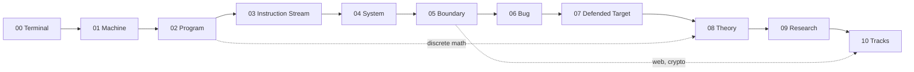

<picture>
    <source media="(prefers-color-scheme: dark)" srcset="assets/brand/ode-white.svg">
    
</picture>

# Open Security Vulnerability Research™

**Security Vulnerability Research education, open to everyone.**

`from zero` · `to original research` · `~4,000h core` · `free-first`

A self-paced, dependency-ordered path from no computer science background to finding, exploiting and disclosing vulnerabilities nobody handed you. It requires no degree: your published work is the credential.

## Principles

1. **Competence over attitude.** You leave a module by passing its gate. Reading the material doesn't count.
2. **Build before you break.** You write a network service before attacking protocols, implement crypto before breaking it, and build an interpreter before attacking a JIT.
3. **Read code and write code.** Assembly at reading fluency is a foundation, not a specialism.
4. **Theory separates researchers from technicians.** Finding a *new* bug class takes knowing where the machinery's assumptions fail.
5. **Your public work is the credential.** Writeups, exploits, patches and advisories count for more than certifications.
6. **Authorization is the boundary, and it is written down.** No skill level makes the document stop mattering.

## Rules

| # | Rule |
|---|------|
| 1 | **Gates are the only exit.** Pass the gate unaided or stay in the module. Take three attempts over at least two weeks; after two consecutive failures, go back to a prerequisite. |
| 2 | **Ship something public every 14 days.** A writeup, a tool, a solved challenge. |
| 3 | **No C before the machine model.** Module 01 unlocks C and assembly. |
| 4 | **No exploitation before assembly and OS internals.** Module 04 unlocks exploitation. |
| 5 | **Written authorization or nothing.** Nothing touches a system you don't own until the [module 05](core/05-the-boundary.md) legal gate is passed. |
| 6 | **Theory before analysis tooling.** Module 08 unlocks symbolic execution, JIT and deobfuscation work. |
| 7 | **Use the tool, but do the technique by hand first.** Debuggers, disassemblers and exploit libraries are fine from day one. Don't automate a technique until you've done it by hand three times. |

## Curriculum Structure

| # | Module | Goal | Hours |
|---|--------|------|-------|
| **Prerequisites** | | | |
| 00 | [The Terminal](prerequisites/00-the-terminal.md) | Shell, editor, git, one scripting language, and the math floor. | 30–50 |
| **Core** | | | |
| 01 | [The Machine](core/01-the-machine.md) | What a computer physically does, from NAND to CPU. | 45–75 |
| 02 | [The Program](core/02-the-program.md) | C, memory, data structures, discrete math. | 320–480 |
| 03 | [The Instruction Stream](core/03-the-instruction-stream.md) | Read x86-64 without a decompiler. | 200–300 |
| 04 | [The System](core/04-the-system.md) | Loader, kernel, syscalls, binary formats, networking. | 300–420 |
| 05 | [The Boundary](core/05-the-boundary.md) | Trust boundaries in access control, crypto, web and law. | 250–380 |
| 06 | [The Bug](core/06-the-bug.md) | Memory corruption with mitigations off. | 450–650 |
| 07 | [The Defended Target](core/07-the-defended-target.md) | Mitigations on, reliably, on two architectures. | 550–850 |
| 08 | [The Theory](core/08-the-theory.md) | Automata, compilers, dataflow, static analysis. | 160–260 |
| 09 | [The Research](core/09-the-research.md) | Audit, fuzz, triage, disclose. | 600–1,000+ |
| **Tracks** | | | |
| 10 | [Tracks](tracks/README.md) | One or two specialisations, past the published edge. | 600+ each |

Module 07 is the employability line, for exploit development and offensive security engineering. Modules 08–10 are what research takes.

### Dependency graph

### Prerequisites

[Module 00](prerequisites/00-the-terminal.md): algebra fluency, mathematical notation, a shell, git and Python. If you already work in a terminal every day, take the gate and move on.

### Core

[Modules 01–09](core/) are the shared foundation. Everyone walks the same road. Each module has the same parts:

- **Requires:** the gate that must be passed first.
- **Outcomes:** what you can do on exit.
- **Resources**, tagged by role:
  - `Core`: do it.
  - `Alt`: a swap for a Core item, not an addition.
  - `Ref`: look things up in it; don't read it cover to cover.
  - `Paper`: read the original.
  - `Practice`: reps.
- **Milestones:** rough hour marks to check pace against.
- **Ship:** the public artifact that closes the module.
- **Gate:** an unaided pass/fail test.

### Tracks

[Specialisations](tracks/README.md) open only after module 09. Choose on evidence of where you are strongest, and choose at most two.

## Placement

Every gate is also the entry test for the next module. Take the gates cold, in order, and start at the first one you fail.

| Background | Take these gates |
|------------|------------------|
| Never used a terminal | Start at 00 |
| Sysadmin / IT, some scripting | 00, 01 → most start at 02 |
| Web or application developer | 02 (most fail the stack-frame drawing) |
| C / Rust systems engineer | 02, 03 |
| Network engineer, SOC / blue team | 02, 03, 05 |
| CS graduate | 04, then 08 |
| CTF exploitation player | 06, 07 |

Nobody skips the [module 05](core/05-the-boundary.md) legal gate or the 14-day shipping rule.

## Guides

- [Legal scope, lab and disclosure](guides/legal-and-lab.md)
- [Spending: hardware, books, courses, certifications](guides/spending.md)
- [Pitfalls: failure modes and their early symptoms](guides/pitfalls.md)
- [Progress tracker](progress.md)

## Scope

OSVR produces a researcher capable of independent discovery in one domain. It does **not** cover cryptanalysis of primitives, baseband/TEE, automotive/ICS, full multi-boundary chains, or red-team operations (C2, implants, EDR evasion). Each of those needs dedicated work beyond this path.

## Known gaps

- No free structured resource exists for CET/shadow-stack bypass or the Windows heap.
- No resource exists for the core activity of module 09: choosing a target on your own and auditing it until something gives.
- Hour estimates are judgement, not data. Recalibrate after module 02.
- Placing theory at 08 instead of earlier is a judgement call. The counter-argument (dataflow would help in 06–07) is strong.

---

OSVR merges and supersedes [THC](https://github.com/itsbadsignal/thc) and [NAND to 0-Day](https://github.com/itsbadsignal/nandto0day). Structure inspired by [OSSU](https://github.com/ossu/computer-science) and [Teach Yourself CS](https://teachyourselfcs.com/). Every resource belongs to the people who built it; OSVR only orders them.
